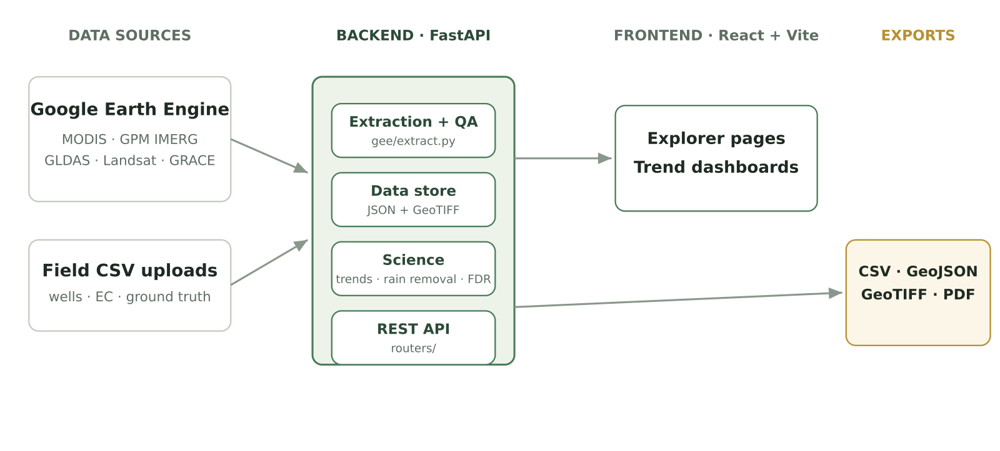
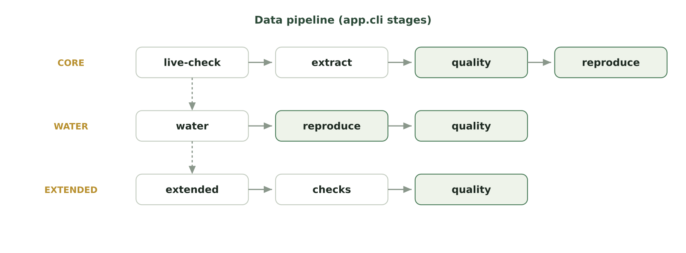

<div align="center">

# **GlobalClimateLens**


**Earth-observation analytics for long-term environmental change**

First research case: **Banni Grasslands, Kutch, Gujarat, India (2001–2024)**

[](https://www.python.org/)
[](https://fastapi.tiangolo.com/)
[](https://react.dev/)
[](https://www.typescriptlang.org/)
[](https://earthengine.google.com/)

[**Live app**](https://banni-app.livelygrass-8df5f932.centralindia.azurecontainerapps.io) · [Datasets](docs/DATASETS.md) · [Methodology](docs/METHODOLOGY.md) · [Setup](docs/SETUP.md)

</div>

---

GlobalClimateLens retrieves satellite series from Google Earth Engine, runs trend, regression and rainfall-adjusted analyses, and exports results with full provenance. Every number is computed from stored data — nothing is hard-coded, and there is no silent fallback to fake data.

**Headline result (Banni, 2001–2024).** Monsoon greening of **+0.0051 NDVI/yr**. Rainfall explains about two-thirds of it; a residual of **+0.0017 NDVI/yr** remains after rainfall is removed (Hamed–Rao Mann–Kendall, **p = 0.006**) and holds up under a second sensor, a second index and several analysis windows. The trend is a satellite-derived quantity — it does not, on its own, identify a cause, a plant species or a groundwater change.

## Architecture

<div align="center">

</div>

<div align="center">

</div>

## Quick start

Requirements: Python 3.11+ and Node 20+. The extracted Banni data ships in `data/`, so the app runs without Earth Engine credentials.

```bash
git clone https://github.com/DevloperHS/banni-climate-lens.git
cd banni-climate-lens

python -m venv .venv && . .venv/bin/activate      # Windows: .\.venv\Scripts\Activate.ps1
pip install -r backend/requirements.txt
cd frontend && npm install && cd ..
```

Run in two terminals:

```bash
cd backend  && python -m uvicorn app.main:app --port 8000
cd frontend && npm run dev          # open http://localhost:5173/dashboards
```

Re-extracting data, the full CLI pipeline and Earth Engine setup are in [docs/SETUP.md](docs/SETUP.md).

## Status

| Area | State |
|---|---|
| Frontend, API, statistics, exports | Done, tested |
| Earth Engine extraction (live, 12–13 Nov 2026) | Done |
| Handover reproduction — all 9 figures | Done |
| Aqua / EVI robustness checks | Done |
| Geometry — handover rectangle (9,751 km²) | No verified grassland polygon |
| Groundwater | CSV upload only; no well data yet |
| Salinity | Landsat SI1 proxy, unvalidated |
| Landsat species classification | Not attempted (no ground-truth labels) |

Full item-by-item status: [docs/FINAL_COMPLETION_REPORT.md](docs/FINAL_COMPLETION_REPORT.md).

## Stack

**Backend** FastAPI · Pydantic · NumPy · SciPy · pandas · statsmodels · rasterio · ReportLab
**Frontend** React 18 · TypeScript · Vite · Recharts · Leaflet
**Data** Google Earth Engine  **Tests** pytest · Vitest · Playwright

## Documentation

[Setup](docs/SETUP.md) · [Architecture](docs/ARCHITECTURE.md) · [Datasets](docs/DATASETS.md) · [Methodology](docs/METHODOLOGY.md) · [API](docs/API_DOCUMENTATION.md) · [Deployment](docs/DEPLOYMENT.md) · [Contributing](docs/CONTRIBUTING.md)

---

<div align="center">

**Team Aryavart** — NASA Space Apps 2026 · Earth System Trend Detective

</div>
