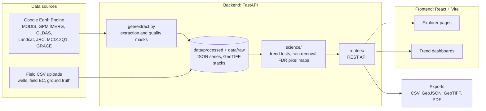
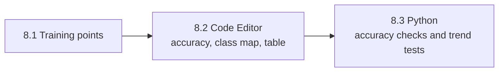

<div align="center">

# 🌍 GlobalClimateLens

**Earth-observation analytics for long-term environmental change**

First research case: **Banni Grasslands, Kutch, Gujarat, India (2001 to 2024)**

[](https://www.python.org/)
[](https://fastapi.tiangolo.com/)
[](https://react.dev/)
[](https://www.typescriptlang.org/)
[](https://vitejs.dev/)
[](https://earthengine.google.com/)

[](#-project-status)
[](docs/DATASETS.md)
[](#6-tests)
[](#7-docker-optional)

</div>

---

Select a region and period, retrieve satellite-derived series from **Google Earth Engine**, run trend, regression and rainfall-adjusted analyses, inspect gridded layers and FDR-corrected pixel trends, and export **CSV, GeoJSON, GeoTIFF and PDF** with full provenance.

> [!IMPORTANT]
> **Scientific integrity rules built into the platform**
> - No observation, statistic or finding is hard-coded. Everything shown is computed from stored series.
> - Without data the UI shows an explicit empty state. There is **no silent fallback to fake data**.
> - A clearly labelled **synthetic sample** (toy model) can be generated to explore the interface. It lives in a separate store and is badged *SYNTHETIC SAMPLE* in the UI, API (`meta.synthetic`), CSV, PDF and chart PNGs.
> - Trends describe satellite-derived quantities. They never identify causes, species or groundwater change.

## 📑 Contents

- [How it works](#-how-it-works)
- [Project status](#-project-status)
- [Commands](#-commands)
  - [1. Get the code](#1-get-the-code)
  - [2. Install](#2-install)
  - [3. Connect Google Earth Engine](#3-connect-google-earth-engine)
  - [4. Download and analyse the data](#4-download-and-analyse-the-data)
  - [5. Run the app](#5-run-the-app)
  - [6. Tests](#6-tests)
  - [7. Docker (optional)](#7-docker-optional)
  - [8. Reproduce the Prosopis research](#8-reproduce-the-prosopis-research)
- [Documentation](#-documentation)
- [Stack](#-stack)
- [Layout](#-layout)

## 🧭 How it works



## 📊 Project status

Legend: ✅ done · ⚠️ done with a limitation · ⏳ in progress · ⛔ not done

| | Area | State |
|:-:|---|---|
| ✅ | **Frontend, API, statistics, exports** | Frontend (12 pages including the trend dashboards), backend API, statistics engine, pixel analysis, exports and reports are implemented and tested (see [Tests](#6-tests)). |
| ✅ | **Earth Engine extraction** | `backend/app/gee/extract.py` is implemented and was **run against live Earth Engine** (12-13 Nov 2026): NDVI, rainfall, ET, soil moisture, LST day/night, Landsat NDVI, JRC + MNDWI surface water, MCD12Q1 land cover, GRACE (CRI mascons), Aqua NDVI, EVI and the raster stacks. |
| ✅ | **Real Banni results** | Committed under `data/processed/` (series and raster stacks) and `data/raw/` (raw extraction records). `python -m app.cli reproduce` reproduces all 9 handover figures. |
| ✅ | **Trend dashboards** (`/dashboards`) | Rain and Green, Water and Heat, Where It Changed: one map and one year slider, a result card per factor, a "before you trust this" box and a sources panel, all computed from stored data (`/api/dashboards/{id}`). |
| ✅ | **Handover reproduction** | `/api/statistics/handover-reproduction`: all 9 handover figures reproduce from the real data (`python -m app.cli reproduce`). |
| ✅ | **Aqua / EVI checks** (brief s.7) | Aqua NDVI (`MODIS/061/MYD13Q1`) and Terra EVI (`MOD13Q1`) extracted with the handover protocol. Trend and rain-removed tests are repeated over the common years 2002-2024 (`python -m app.cli checks`, `/api/statistics/sensor-index-checks`, *Sensor and index checks* panel on Rain and Green). On the real data both agree with Terra NDVI in the monsoon and the dry season. |
| ⚠️ | **Geometry** | Handover rectangle (9,751 km²) is used. **No verified grassland polygon found**; support for supplying one is built. |
| ⛔ | **Landsat species-level classification** | **Not attempted** (no ground-truth labels). Landsat NDVI comparison with MODIS is implemented. A separate Sentinel-2 Prosopis map was made for the research below. |
| ✅ | **Prosopis research** (`research/prosopis_rf/`) | Sentinel-2 random forest with 159 hand-labelled points (accuracy 0.96 by the script's test, 0.76 with whole locations held out), Prosopis vs no-Prosopis greening trends, robustness checks and the 25 % "remove the factor" test. **Prosopis is not the driver of the greening.** See [Reproduce the Prosopis research](#8-reproduce-the-prosopis-research). |
| ⏳ | **Farming test** (`research/prosopis_rf/scripts/12_farming_test.py`) | Farmland map export running; results not yet in the report. |
| ⚠️ | **Groundwater** | No automatic CGWB / India-WRIS download (the portal requires a sign-in with CAPTCHA). Measured levels are analysed from a CSV upload (`lat`/`lon` columns place wells on the Water and Heat map). **No well data uploaded yet.** |
| ⚠️ | **Salinity** | Landsat spectral proxy (SI1) extracted, but **unvalidated** for Banni until compared with field EC measurements. |
| ✅ | **Final phase** | Security, pipeline, report generator, new analyses and deployment assets are implemented and tested. See [`docs/FINAL_COMPLETION_REPORT.md`](docs/FINAL_COMPLETION_REPORT.md) for item-by-item status (COMPLETE / BLOCKED / NOT IMPLEMENTED). |
| ℹ️ | **Database** | File-based store (JSON + GeoTIFF) rather than PostgreSQL/PostGIS. See [`docs/ARCHITECTURE.md`](docs/ARCHITECTURE.md). |

## 💻 Commands

All commands are for **Windows PowerShell**, starting from the repository root.

> [!TIP]
> Activate the virtual environment **once per terminal** (step 2). After that, `python`, `pip` and `earthengine` all come from it.
> On macOS/Linux activate with `source .venv/bin/activate`.

### 1. Get the code

```powershell
git clone https://github.com/DevloperHS/banni-climate-lens.git
cd banni-climate-lens
```

### 2. Install

**Requirements:** Python 3.11+ and Node 20+.

```powershell
python -m venv .venv
.\.venv\Scripts\Activate.ps1                       # activate (do this in every new terminal)
pip install -r backend\requirements.txt            # runtime (includes earthengine-api)
pip install -r backend\requirements-dev.txt        # adds pytest, httpx, pypdf, pip-audit for the tests
cd frontend; npm install; cd ..
copy .env.example .env
notepad .env                                       # edit settings (never commit .env)
```

<details>
<summary><b>PowerShell refuses to run <code>Activate.ps1</code>?</b></summary>

Allow scripts for this terminal only, then activate again:

```powershell
Set-ExecutionPolicy -Scope Process -ExecutionPolicy RemoteSigned
.\.venv\Scripts\Activate.ps1
```

`source .venv/Scripts/activate` is the Git Bash form; it does not work in PowerShell.

</details>

### 3. Connect Google Earth Engine

> [!NOTE]
> **Only needed to download new data.** The extracted Banni data is already in `data/`, so the app works without this step.

To re-extract or add variables:

| Step | What to do |
|:-:|---|
| 1 | Use a personal Google account with 2-Step Verification on. Create a Cloud project at <https://console.cloud.google.com/earth-engine>. |
| 2 | Enable the Earth Engine API: <https://console.cloud.google.com/apis/library/earthengine.googleapis.com>. |
| 3 | Register the project for noncommercial use at `https://code.earthengine.google.com/register?project=YOUR-PROJECT-ID`, then complete the questionnaire at <https://console.cloud.google.com/earth-engine/configuration>. Keep the free **Community** tier (no billing). |
| 4 | Sign in from this machine and set the default project (venv activated), as below. |
| 5 | Set the project in `.env`, as below. |

**Step 4: sign in**

```powershell
earthengine authenticate
earthengine set_project YOUR-PROJECT-ID
notepad .env
```

**Step 5: `.env` settings**

```ini
GCL_EE_PROJECT=YOUR-PROJECT-ID
GCL_EE_SERVICE_ACCOUNT=
GCL_EE_PRIVATE_KEY_FILE=
```

> [!WARNING]
> Leave the two service-account lines **empty**. If they are filled in, the app uses service-account mode instead of your login.

For a server, use a service account instead: grant it *Earth Engine Resource Viewer* (and *Service Usage Consumer* if needed), save its JSON key under `secrets/` and fill in all three lines. See [`docs/SETUP.md`](docs/SETUP.md).

### 4. Download and analyse the data

The command-line pipeline. With the venv activated, **`cd backend` first**: the `app.cli` module is only found from inside `backend/`. Every command accepts `--region banni --start 2001 --end 2024`.

Run the stages in this order, checking `quality` after each download stage:


```powershell
cd backend
python -m app.cli live-check
python -m app.cli extract
python -m app.cli quality
python -m app.cli reproduce
python -m app.cli water
python -m app.cli reproduce
python -m app.cli quality
python -m app.cli extended
python -m app.cli checks
python -m app.cli quality
```

| Command | What it does |
|---|---|
| `live-check` | Sign-in, connection, and every collection/band the app reads |
| `extract` | MODIS NDVI + IMERG rainfall 2001-2024, plus the handover's 2001/2023 NDVI test |
| `quality` | Completeness, missing months and unit checks per series |
| `reproduce` | Handover protocol vs its 9 reported figures (never forced to match). Run it again after `water`, once ET and soil moisture exist, to cover all 9 figures. |
| `water` | Evapotranspiration + GLDAS root-zone and surface soil moisture |
| `extended` | All remaining series (LST, Landsat, surface water, land cover, GRACE, Aqua, EVI ...) and the map raster stacks |
| `checks` | Aqua NDVI + EVI: extract, then repeat the trend and rain-removed tests vs Terra NDVI |

**Other commands**

```powershell
python -m app.cli verify-metadata
python -m app.cli validate-csv groundwater path\to\wells.csv
```

| Command | What it does |
|---|---|
| `verify-metadata` | Check dataset IDs, bands, units and scales against Google's catalogue (no sign-in needed) |
| `validate-csv <kind> <file>` | Check a field CSV offline before uploading. Kinds: `groundwater`, `field-ec`, `ground-truth`. Column layouts are in `data-templates\`. |

`extract`, `water` and `checks` stop at the first failure and store nothing incomplete. `extended` runs every task and prints a summary of what succeeded. The same jobs can be started from the app under **Settings > Data processing**.

**Where the output goes**

| Path | Contents |
|---|---|
| `data/processed/series/banni/*.json` | Series |
| `data/processed/rasters/banni/*.tif` | Map stacks |
| `data/raw/banni/` | Timestamped raw records |

<details>
<summary><b>⚠️ Start over (deletes data)</b></summary>

To re-extract everything from scratch, clear the data folders from the repository root, then run the sequence above again.

```powershell
Remove-Item data\raw\*, data\processed\*, data\cache\* -Recurse -Force -Exclude .gitkeep
```

> [!CAUTION]
> This deletes the extracted Banni data that is committed in this repo, so only do it when you mean to replace it. `git checkout -- data` restores the committed copy.

</details>

### 5. Run the app

Use two terminals:

```powershell
# terminal 1 (venv activated): API on http://127.0.0.1:8000 (interactive docs at /docs)
cd backend
python -m uvicorn app.main:app --port 8000
```

```powershell
# terminal 2: web app on http://localhost:5173 (/api is proxied to port 8000)
cd frontend; npm run dev
```

Open <http://localhost:5173/dashboards> for the three trend dashboards.

> [!NOTE]
> Without data you will see empty states. To explore the interface with toy values use **Settings > Enable demonstration mode > Generate sample**. Everything shown in that mode is labelled synthetic.

**Useful API checks** while the backend runs:

```powershell
curl http://127.0.0.1:8000/api/health
curl "http://127.0.0.1:8000/api/health/earthengine"
curl "http://127.0.0.1:8000/api/statistics/handover-reproduction?region=banni&source=processed"
curl "http://127.0.0.1:8000/api/statistics/sensor-index-checks?region=banni&source=processed"
curl "http://127.0.0.1:8000/api/dashboards/rain_green?region=banni&source=processed"
```

### 6. Tests

```powershell
cd backend;  python -m pytest -q
cd frontend; npm test
cd frontend; npm run typecheck
cd frontend; npx playwright install chromium; npm run e2e
cd frontend; npm run build
```

| Command | What it runs |
|---|---|
| `python -m pytest -q` | Science + API + jobs (venv activated; uses a temporary data folder, never your data) |
| `npm test` | Vitest component tests |
| `npm run typecheck` | TypeScript check |
| `npm run e2e` | End-to-end tests (starts its own servers/ports) |
| `npm run build` | Production build into `frontend/dist` |

Results of the last full run are recorded in [`docs/TEST_RESULTS.md`](docs/TEST_RESULTS.md).

### 7. Docker (optional)

```powershell
copy .env.production.example .env.production   # then edit; never commit it
docker compose up --build                      # API + built frontend in one container
```

The app is then served on <http://127.0.0.1:8000>. See [`docs/DEPLOYMENT.md`](docs/DEPLOYMENT.md).

### 8. Reproduce the Prosopis research

Tests whether the spread of *Prosopis juliflora*, or farmland, explains why Banni is greener than its rain explains. The answer so far: **Prosopis is not the driver** (greening also happens where there are no trees or bushes at all). Full findings, in plain language: [`research/prosopis_rf/REPORT.md`](research/prosopis_rf/REPORT.md).

> [!NOTE]
> **Before you start**
> - Step 3 is done: Earth Engine signed in and `GCL_EE_PROJECT` set in `.env`.
> - You can open the [Earth Engine Code Editor](https://code.earthengine.google.com/) with the same Google account and project.
> - The whole run uses about **20 EECU-hours** of the free Community tier's 150 per month (three map exports of about 7 each).
> - Earth Engine export tasks can take from minutes to a few hours. Scripts that start one wait for it to finish.



#### 8.1 Training points

```powershell
cd research\prosopis_rf\scripts
python 03_build_training_points.py
```

Rebuilds `labelling/training_points.csv` and `gee/manual_points.js` from the committed by-eye decisions in `labelling/visual_labels.csv` (39 Prosopis woodland, 34 mixed, 53 water, 33 saline brush points, at least 150 m apart). The output is identical to the committed files.

<details>
<summary><b>Redo the labelling from scratch (optional)</b></summary>

Candidates are drawn at random, so a new run gives new points that must be judged by eye again. Run the three candidate rounds, each followed by its image sheets:

```powershell
python 01_candidate_points.py
python 02_make_chips.py
python 01b_candidate_points_round2.py
python 02_make_chips.py candidates_round2.csv r2_
python 01c_candidate_points_round3.py
python 02_make_chips.py candidates_round3.csv r3_
```

Then look at every sheet in `labelling/sheets/`, record one decision per candidate (accept, relabel or reject) in `labelling/visual_labels.csv`, and run `python 03_build_training_points.py`.

> [!CAUTION]
> The sheets are cut from **Esri World Imagery**, whose terms do not allow the tiles to be shared or redistributed. They stay on your machine (`labelling/sheets/` and `data/cache/esri_tiles/` are git-ignored). Delete them when labelling is done.

</details>

#### 8.2 Earth Engine Code Editor

In `gee/stage1_classmap.js` and `gee/stage2_table.js`, replace `banni-trend-2026` with **your project ID** (one line in each file). Then paste each file below into the Code Editor, in order, and press **Run**:

| # | Paste | Then |
|:-:|---|---|
| 1 | `gee/banni_rf_with_points.js` | The console prints **Overall accuracy** and **Kappa** (about 0.96 and 0.95). Do not start its export task: it fails by design (the original script's bug, see REPORT section 5). |
| 2 | `gee/stage1_classmap.js` | **Tasks** tab > **Run** `banni_rf_classmap_2023`. Wait until it has finished. |
| 3 | `gee/stage2_table.js` | **Tasks** tab > **Run** `banni_ndvi_by_prosopis_chirps`. Download the CSV from Google Drive and save it as `research/prosopis_rf/results/banni_ndvi_by_prosopis_chirps.csv` (replaces the committed copy). |

#### 8.3 Accuracy checks and trend tests

Still in `research\prosopis_rf\scripts`, venv activated:

```powershell
python 04_run_rf_python.py
python 05_analyse_trends.py
python 06_point_holdout_accuracy.py
python 07_point_holdout_detail.py
python 09_robustness.py
python 10_brush_vs_woody.py
python 11_remove_prosopis.py
python 12a_export_cropland.py
python 12_farming_test.py
cd ..\..\..
```

| Script | What it does | Writes to `results/` |
|---|---|---|
| `04_run_rf_python.py` | Runs the Code Editor script again through Python as a cross-check | `rf_accuracy_python.json`, `banni_ndvi_by_prosopis_chirps_python.csv` |
| `05_analyse_trends.py` | Main test: greening in high- vs low-Prosopis pixels, with rain removed (CHIRPS and IMERG) | `trend_tests.json` |
| `06_point_holdout_accuracy.py` | Stricter accuracy: whole locations held out, 5 seeds | `rf_accuracy_point_holdout.json` |
| `07_point_holdout_detail.py` | One of those runs in full detail, location by location (seed 2) | `point_holdout_seed2.json`, `point_holdout_seed2_locations.csv` |
| `09_robustness.py` | Other cutoffs (30/10, 50/2) and masks from a 2017 map. Exports `banni_rf_classmap_2017` first if missing | `robustness_tests.json`, `robustness_series.csv` |
| `10_brush_vs_woody.py` | Pixels with no trees or bushes vs woody pixels. Needs the 2017 map from `09` | `brush_vs_woody_tests.json`, `brush_vs_woody_series.csv` |
| `11_remove_prosopis.py` | Removes Prosopis pixels and applies the 25 % effect rule | `remove_prosopis_tests.json`, `remove_prosopis_series.csv` |
| `12a_export_cropland.py` | Exports farmland shares (ESA WorldCover, Dynamic World) as an asset | `banni_cropland_fractions_modis` asset |
| `12_farming_test.py` | Removes farmland pixels and applies the 25 % effect rule, in the script box and the platform box | `farming_tests.json`, `farming_series.csv` |

`04_run_rf_python.py --own-map` exports its own 2023 map instead of reading the Code Editor one (about 7 more EECU-hours). `04b_export_class_maps.py` and `08_robustness_checks.py` are earlier drafts replaced by `09`; you do not need to run them.

**What you should see**

| Check | Expected |
|---|---|
| Accuracy, script's own test (`1` in 8.2) | about 0.96, kappa about 0.95 (varies slightly between runs) |
| Accuracy, whole locations held out (`06`) | about 0.76 |
| High minus low Prosopis greening (`05`) | +0.0015 per year, p = 0.063 (not significant) |
| No trees or bushes, rain removed (`10`) | still greening, p = 0.001 to 0.002 |
| Prosopis woodland removed (`11`) | trend changes by less than 13 %: neutral |

Every script, its inputs and its outputs are described in [`research/prosopis_rf/README.md`](research/prosopis_rf/README.md).

## 📚 Documentation

| Document | Covers |
|---|---|
| [Final completion report](docs/FINAL_COMPLETION_REPORT.md) | Item-by-item project status |
| [Prosopis research report](research/prosopis_rf/REPORT.md) | Does Prosopis explain Banni's greening? Findings in plain language |
| [Prosopis research files](research/prosopis_rf/README.md) | Every research script, its inputs and outputs |
| [Known issues](docs/KNOWN_ISSUES.md) | Open problems, including the original script's export bug and IMERG vs CHIRPS |
| [Security review](docs/SECURITY_REVIEW.md) | Security controls and findings |
| [Validation report](docs/SCIENTIFIC_VALIDATION_REPORT.md) | Scientific validation of the results |
| [Dataset verification](docs/DATASET_VERIFICATION.md) | Dataset IDs, bands and units checked against the catalogue |
| [Architecture](docs/ARCHITECTURE.md) | System design and data store |
| [Setup](docs/SETUP.md) | Detailed installation and Earth Engine setup |
| [Datasets](docs/DATASETS.md) | Every dataset used and its limitations |
| [Methodology](docs/METHODOLOGY.md) | Statistical methods |
| [API](docs/API_DOCUMENTATION.md) | REST endpoints |
| [Deployment](docs/DEPLOYMENT.md) | Docker and production deployment |
| [Contributing](docs/CONTRIBUTING.md) | How to contribute |

## 🧰 Stack

| Layer | Technologies |
|---|---|
| **Frontend** | React 18, TypeScript, Vite, Tailwind 4, Recharts, Leaflet, React Router, TanStack Query |
| **Backend** | FastAPI, Pydantic |
| **Science** | NumPy, SciPy, pandas, statsmodels, rasterio, Pillow, matplotlib, ReportLab |
| **Data** | earthengine-api |
| **Testing** | pytest, Vitest, Testing Library, Playwright |

## 📁 Layout

```text
.
├── backend/
│   ├── app/
│   │   ├── core/        config, catalog, store, regions, security
│   │   ├── science/     stats engine, pixel trends, handover reproduction
│   │   ├── gee/         Earth Engine client and extraction
│   │   └── routers/     HTTP routes, including the dashboards
│   └── tests/           pytest (science validation, API, jobs)
├── frontend/
│   ├── src/             pages, components, lib, state, test (UI)
│   └── e2e/             Playwright end-to-end tests
├── data/
│   ├── processed/       extracted Banni data (committed)
│   ├── raw/             raw extraction records (committed)
│   ├── extras/          banni_rf.js as received, and copies of its exported table
│   ├── sample/          synthetic sample (git-ignored)
│   └── cache/           job logs, Esri image tiles (git-ignored)
├── data-templates/      CSV templates for wells, field EC and ground truth
├── docs/                documentation
└── research/
    └── prosopis_rf/
        ├── gee/         Earth Engine Code Editor scripts
        ├── labelling/   candidates, by-eye decisions, final training points
        ├── scripts/     Python steps 01 to 12
        ├── results/     accuracy, trend tests, tables, map image
        ├── README.md    how each file is made
        └── REPORT.md    findings in plain language
```
