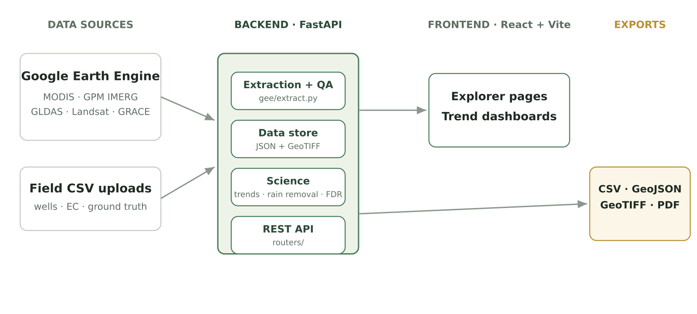
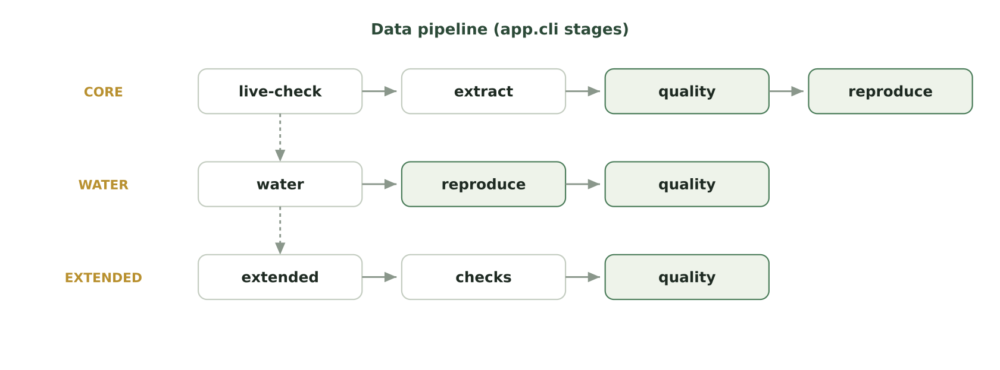

# Architecture

<div align="center">

</div>

## Principles

1. **Science is separated from presentation.** `backend/app/science/*` is pure NumPy / SciPy / statsmodels with no web or Earth Engine imports; the UI only renders what the API returns.
2. **Earth Engine does the minimum server-side** — quality mask, scale factor, regional mean per image. All temporal aggregation and unit conversion happens in `science/processing.py`, which is unit-tested without Earth Engine.
3. **Provenance travels with the data.** Every stored series carries its dataset id, provider, variable, resolution, unit, scale factor, quality filter, processing period, retrieval date and config. API responses expose it as `meta`.
4. **Observed and synthetic data never share storage.**

## Data flow

```
Earth Engine ──(jobs.py, background thread)──> gee/extract.py ──> science/processing.py (aggregate, convert)
  └──> core/store.py   data/processed/series/<region>/<key>.json
                       data/processed/rasters/<region>/<key>_<season>.tif

user CSV upload (groundwater) ───────────────────────────────────> same store (kind="user-supplied")
core/sample.py (explicit, synthetic) ──────────────────────────────> data/sample/...  (kind="synthetic")

store ──> services.py (load, aggregate, cache) ──> science/stats.py, science/pixel.py
      ──> routers ──> JSON / PNG / GeoTIFF / CSV / PDF ──> React
```

The CLI pipeline that populates this store, stage by stage:

<div align="center">

</div>

## Backend modules

| Path | Role |
|---|---|
| `core/config.py` | Env-driven settings (`GCL_*`); never holds secrets in code |
| `core/regions.py`, `config/regions.json` | Region registry — **add a study area by adding a JSON entry** |
| `core/catalog.py` | Dataset specs (id, provider, unit, scale factor, QA, limitations) |
| `core/store.py` | File store; `processed` vs `sample` roots |
| `core/sample.py` | Synthetic generator (labelled) |
| `science/processing.py` | Scale factors, QA bit decoding, composite→month aggregation |
| `science/timeseries.py` | Seasons, annual/seasonal aggregation with coverage rules, anomalies |
| `science/stats.py` | Mann–Kendall, Hamed–Rao, Sen + CI, OLS + diagnostics + HAC, correlation, BH–FDR, rainfall-adjusted analysis, event study |
| `science/pixel.py` | Vectorised per-pixel MK/Sen, BH–FDR, GeoTIFF IO, PNG rendering |
| `gee/client.py` | Auth (service account or user credentials), status, setup messages |
| `gee/extract.py` | Per-dataset extraction, raster stack export |
| `jobs.py` | Single-worker background queue; history in `data/cache/jobs.json` |
| `services.py` | Orchestration, caching (keyed by file mtime), insight text generation |
| `routers/*` | HTTP layer; one generic router factory serves vegetation / rainfall / temperature / water |

## Caching

Trend, adjusted-analysis and pixel results are cached in-process, keyed by the data file's mtime and the request parameters, so repeated views do not recompute and new data invalidates the cache automatically. Earth Engine is only called by explicit jobs; reads never hit Earth Engine.

## Frontend

React Router pages → `useApi` (TanStack Query) → typed `lib/api.ts`. Global state (region, period, data source, theme) lives in `state/AppState.tsx`, persisted in `localStorage` (guarded). Shared analysis panels (`components/analysis.tsx`) are reused across pages. Every query goes through `<Q>` / `<RequireData>`, giving consistent loading, error and empty states.

## Design decisions (and why)

- **No PostgreSQL / PostGIS / SQLAlchemy.** The persisted objects are a few JSON series and GeoTIFF stacks per region with no relational queries; a file store is simpler, reproducible and inspectable. If multi-user writes or spatial queries are needed, replace `core/store.py` (the only module that touches storage) with a PostGIS-backed implementation.
- **No GeoPandas / Xarray.** Not needed: regions are rectangles, and rasters are handled with rasterio + NumPy.
- **No COG output.** Exports are standard compressed GeoTIFF; COG conversion is a post-processing step if tiling is required.
- **PyMannKendall** is used only as an independent reference in tests; the engine implements MK / Hamed–Rao itself so Sen's slope respects the actual time gaps.
- **Leaflet image overlays** (server-rendered PNG) are used for rasters instead of vector pixel polygons — a 250 m raster over Banni has ~170k pixels.

## Final-phase additions

| Module | Role |
|---|---|
| `core/security.py` | Optional API-token dependency, `safe_name`, security-header middleware, log redaction, CSV/text sanitising |
| `core/groundwater.py`, `core/fielddata.py` | Groundwater import / validation / per-well analysis; storage of field EC and ground-truth labels |
| `science/raster_qc.py` | Raster QC, grid alignment / resampling, water masks, difference maps, cross-resolution agreement, dry-season persistence indicator |
| `science/validation.py` | Ground-truth and EC validation statistics (refuses small samples) |
| `science/multivar.py` | Multi-variable comparison (association vs prediction vs causation) |
| `science/handover.py` | Reproduction of the handover protocol |
| `reporting.py` | PDF generator built from stored results at request time |
| `jobs.py` + `gee/cancel.py` | Pipeline control: progress, cancel, retry, logs, crash recovery |
| `gee/extract.py` | Water-masked NDVI, salinity proxy, Landsat MNDWI water, tiled raster export on a shared region-anchored grid |
| `verify_metadata.py` | Automated check of collection / band / unit / scale / coverage against Google's STAC catalogue |
| `cli.py` | `live-check`, `extract`, `quality`, `reproduce`, `water`, `verify-metadata` |

**Key guarantees.** Raster stacks for one region and scale share one pixel grid by construction (`grid_for`), so masks and layers align. Every raster read is QC-checked; writes are atomic (temp + rename). A series is stored only after schema and completeness validation, and jobs never convert failures into data.