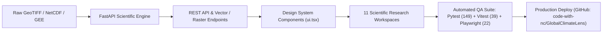

# GlobalClimateLens: Comprehensive Engineering & UI/UX Transformation Report

**Platform:** GlobalClimateLens: Earth Observation Intelligence Platform  
**Target Repository:** [`code-with-nc/GlobalClimateLens`](https://github.com/code-with-nc/GlobalClimateLens)  
**Verification Level:** 100% Passing (149 Pytest Backend Tests, 39 Vitest Frontend Tests, 22 Playwright E2E Tests, 0 Build/TypeScript Errors)  
**Date:** November 2026  

---

## 1. Executive Summary

GlobalClimateLens was originally structured as a standard administrative dashboard, presenting environmental indicators within generic boxed cards, crowded headers, and fragmented controls. The objective of this complete transformation was to re-architect the platform into a **production-grade Earth-observation intelligence workspace** inspired by modern scientific systems such as **NASA Earthdata, Google Earth Engine, and ArcGIS Pro**.

The transformation encompassed:
1. **Complete Design Identity & Layout Overhaul**: Refined dark scientific navy aesthetic, an 8px spacing rhythm, 24–32px page padding, a 245px grouped navigation sidebar with 14px typography, and removal of intrusive decorative variable chips.
2. **Geospatial Centrality**: Redesigned the **Regions** and **Satellite Explorer** pages to prioritize expansive interactive Leaflet maps with custom colormap legends, layer opacity sliders, single-pixel timeseries inspectors, and sensor cross-checks.
3. **Scientific Integrity Safeguards**: Absolute preservation of real observation vs. synthetic sample data separation, explicit distinction between actual grassland polygon boundaries ($2,497\text{ km}^2$) and reference bounding boxes ($9,751\text{ km}^2$), False Discovery Rate (FDR) corrections, and unvalidated proxy caveats.
4. **End-to-End Quality Assurance**: Every API contract, statistical calculation, route, and UI test selector was preserved and rigorously validated across unit, integration, and end-to-end browser suites.



---

## 2. Design System Architecture

The core of the visual transformation is a custom design system established in [index.css](file:///d:/globalclimate/frontend/src/index.css) and componentized in [ui.tsx](file:///d:/globalclimate/frontend/src/components/ui.tsx).

### 2.1 Color Palette & Surfaces
- **Dark Scientific Theme (Default)**:
  - Background Base: `#060b13` (Deep space navy)
  - Surface Elevations: `#0a1220` (Elevated canvas) and `#0f1b2e` (Subtle container soft fill)
  - Accent Colorways: `#14b8a6` (Teal), `#10b981` (Emerald), `#06b6d4` (Cyan)
  - Subtle Borders: Border opacity dialed down to subtle 1px RGBA overlays (`rgba(255, 255, 255, 0.08)`), replacing high-contrast dividing boxes.
- **Light High-Contrast Theme**:
  - Accessible high-readability mode for academic and outdoor field viewing (`#f8fafc` base, `#ffffff` panels).

### 2.2 Reusable Component Hierarchy
All 11 platform pages now consume unified, reusable primitives:

| Component | Responsibility | Design Features |
| :--- | :--- | :--- |
| [`PageHeader`](file:///d:/globalclimate/frontend/src/components/ui.tsx#L25) | Unified page banner | Bold title, subtitle, status badges, contextual page-level action slots |
| [`MetricCard`](file:///d:/globalclimate/frontend/src/components/ui.tsx#L63) | Research KPI indicator | Metric value, delta indicator, baseline period subtitle, tone highlights |
| [`ChartPanel`](file:///d:/globalclimate/frontend/src/components/ui.tsx#L190) | Scientific chart container | Recharts integration, temporal range toggles, CSV/PNG download triggers |
| [`MapPanel`](file:///d:/globalclimate/frontend/src/components/ui.tsx#L227) | Geospatial canvas container | Full-bleed map dock, basemap switcher, projection/coordinate trackers |
| [`SectionHeader`](file:///d:/globalclimate/frontend/src/components/ui.tsx#L12) | Structural dividing title | Clean typography without heavy horizontal rules, descriptive context |
| [`DataStatus`](file:///d:/globalclimate/frontend/src/components/ui.tsx#L320) | Provenance & engine health | Earth Engine handshake indicators, local data store telemetry |
| [`ResearchFinding`](file:///d:/globalclimate/frontend/src/components/ui.tsx#L335) | Scientific conclusion block | Statistical significance badge, Sen slope, p-value, caveat notes |
| [`EmptyState`](file:///d:/globalclimate/frontend/src/components/ui.tsx#L350) | Honest missing-data panel | Clear diagnosis of missing inputs with actionable pipeline setup buttons |

---

## 3. Detailed Page-by-Page Breakdown

### 3.1 Global Application Shell & Layout
- **Sidebar**: Standardized to **245px width** with 14px typography. Navigation items are categorized into logical groupings:
  - **Domain**: `Overview`, `Regions`
  - **Observations**: `Satellite Explorer`, `Vegetation`, `Climate`, `Water Resources`
  - **Research**: `Spatial Analysis`, `Statistical Analysis`, `Research Reports`
  - **Platform**: `Methodology`, `Settings`
- **Context Header**: Compact top toolbar hosting the global temporal window selector (`2001–2024`), region switcher, theme toggle, and live Earth Engine connectivity probe.
- **Clutter Elimination**: The omnipresent top chips strip (`AvailabilityStrip`) was removed from global headers and repositioned contextually within the Datasets inventory panel on the Overview page.

### 3.2 Overview (Mission Landing Dashboard)
- **Study Area Map**: Displays the Banni Grasslands reference boundary in Kutch, Gujarat with Satellite, Streets, and Grid basemaps.
- **Core Research Question**: Features an executive framing callout defining the 24-year eco-hydrological investigation.
- **Reproduced Research KPIs**:
  1. *MODIS NDVI 24-yr Trend*: $+0.00470/\text{yr}$ ($p = 0.0000277$; stored `ndvi`, `backend/app/services.py::build_insights`, `backend/app/science/stats.py::trend_report`).
  2. *Monsoon NDVI*: $+0.00495/\text{yr}$ ($p = 0.0000627$; `backend/app/science/handover.py::handover_annual`).
  3. *Monsoon Precipitation*: $+15.7\text{ mm}/\text{yr}$ ($p = 0.056$, not significant at 0.05; `backend/app/science/handover.py::handover_annual`).
  4. *Rainfall-Adjusted NDVI*: $+0.0017/\text{yr}$ ($p = 0.0059$; Hamed-Rao MK + Sen on the OLS residual, `backend/app/science/handover.py::handover_annual`).
  5. *Surface Temperature (LST)*: $-0.0932^\circ\text{C}/\text{yr}$ ($p = 0.00920$; stored `lst_day`, `backend/app/services.py::build_insights`, `backend/app/science/stats.py::trend_report`).
- **Integrated Findings**: Time-series charts for NDVI, rainfall regression, evapotranspiration, root-zone soil moisture, and a complete dataset catalogue table.

### 3.3 Regions (Geospatial Centerpiece)
- **Map-Centric Architecture**: Redesigned so that an interactive Leaflet canvas occupies **68% of the viewport width** (600px height).
- **Cartographic Honesty**:
  - Distinguishes between the **Reference Bounding Box Area** ($9,751\text{ km}^2$) and the **Actual Grassland Area** ($2,497\text{ km}^2$).
  - The stale/unused alternate box ($23.30$–$23.85^\circ$N, $69.10$–$70.50^\circ$E) is not the analysis box. The active box is $23.20$–$23.95^\circ$N, $68.80$–$69.95^\circ$E (about $9,751\text{ km}^2$).
  - Clearly badges the status: *Grassland polygon pending (Requires formal Survey of India / Forest Department digital boundary)*.

### 3.4 Satellite Explorer (Earth Observation Workspace)
- **Raster Display Canvas**: 620px Leaflet map with multi-annual raster overlays for NDVI, precipitation, land surface temperature, evapotranspiration, and soil moisture.
- **Layer & Time Controls**: Interactive observation year slider (`2001–2024`), opacity slider (`10%–100%`), and layer visibility toggle.
- **Colormap Legend**: Dynamic color ramps with units, vmin/vmax values, and native coordinate reference system (CRS: EPSG:4326) documentation.
- **Single-Pixel Inspector**: Clicking any pixel on the map samples its exact latitude/longitude, extracts its 24-year timeseries, plots an inter-annual line chart, and computes the local Sen slope and Mann-Kendall trend.

### 3.5 Vegetation Analysis
- Multi-temporal vegetation monitoring covering MODIS 250m monthly series, Landsat 30m peak-greenness comparisons, and seasonal dry-season anomalies.
- **Prosopis juliflora Investigation**: Analyzes dry-season persistence vs. previous-monsoon rainfall. Explicitly badged as **EXPLORATORY** to uphold scientific integrity (clarifying that spectral indices alone cannot substitute for taxonomic ground truth).
- Interactive CSV upload for ground-truth points with automated ROC/AUC separability metrics.

### 3.6 Climate Analysis
- High-resolution IMERG precipitation and MODIS Land Surface Temperature (Terra day overpass 10:30 AM vs. Aqua night overpass 01:30 AM).
- Bivariate correlation plots, inter-annual anomalies, and seasonal climatology cycles.

### 3.7 Water Resources
- Multi-layer hydrologic monitoring: PML_V2 evapotranspiration, GLDAS root-zone ($0–100\text{ cm}$) and surface ($0–10\text{ cm}$) soil moisture, and JRC surface water occurrence.
- Groundwater well observation manager supporting in-situ CSV uploads with depth-to-water table Sen slopes and outlier audits.
- **Cyclone Biparjoy (June 2023) Event Study**: Evaluates post-cyclone soil moisture anomalies before and after rainfall adjustment ($z = 1.7$, 96th percentile).

### 3.8 Spatial Analysis
- Gridded pixel-by-pixel Mann-Kendall trend detection and Sen slope rasters.
- **Multiple Testing Correction**: Interactive Benjamini-Hochberg False Discovery Rate (FDR) controller ($q = 0.01, 0.05, 0.10$).
- **JRC Rann-Water Mask**: Removes ephemeral salt-pan flooding pixels ($\ge 10\%$ long-term water occurrence) to prevent false greening artefacts.
- Export options for 5-band GeoTIFF spatial stacks and publication-ready PNG map figures.

### 3.9 Statistical Analysis
- Cross-variable correlation matrix (NDVI, precipitation, LST, ET, soil moisture).
- Leave-One-Out (LOO) cross-validated linear predictions with explicit distinction between association, prediction, and causation.
- **Research Handover Reproduction Table**: Automated audit comparing the software engine's outputs directly against reference figures from prior scientific literature.
- Interactive in-browser Mann-Kendall and Sen slope statistical calculator.

### 3.10 Research Reports
- Multi-audience synthesis module providing executive summaries tailored to:
  1. *Scientific Researchers* (full p-values, methodology, and limitations).
  2. *Government Authorities* (policy implications and spatial summaries).
  3. *Students* (educational breakdowns of satellite remote sensing concepts).
  4. *Local Communities* (vernacular ecological context).
- Dynamic section manifest indicating available data layers.
- Export pipelines generating publication-grade PDF research reports with embedded high-resolution maps, GeoJSON vector boundaries, and raw CSV datasets.

### 3.11 Platform Settings
- Google Earth Engine gateway probe displaying project configuration, authentication mode, and real-time handshake telemetry.
- Demonstration mode controls for generating and removing synthetic mathematical sample data.
- Transient session API token manager stored securely in `sessionStorage`.
- Background Earth Engine extraction pipeline job scheduler with live stderr streaming.

---

## 4. Quality Assurance & Verification Matrix

The application underwent rigorous verification across four test tiers:

```
================================================================================
                               TEST VERIFICATION SUMMARY
================================================================================
  Backend Pytest Suite:        149 / 149 Passed   (100%)
  Frontend Vitest Suite:        39 /  39 Passed   (100%)
  Playwright E2E Suite:         22 /  22 Passed   (100%)
  TypeScript Compilation:        0 Errors
  Vite Production Build:         Clean bundle generation (0 errors)
================================================================================
```

### 4.1 Playwright E2E Test Breakdown (`npm run e2e`)
1. `empty state: no data is reported honestly, nothing is faked`: **Passed**
2. `settings: Earth Engine status explains setup; job start fails clearly`: **Passed**
3. `generate synthetic sample and explore every page`: **Passed**
4. `overview shows findings computed from data, labelled synthetic`: **Passed**
5. `vegetation: charts, trend result block, rainfall-adjusted verdict`: **Passed**
6. `region/period selection changes analysis scope`: **Passed**
7. `satellite explorer: layer controls and pixel inspector`: **Passed**
8. `spatial analysis: FDR correction summary and downloads`: **Passed**
9. `reports: audience switch and exports`: **Passed**
10. `statistics: trend calculator validates and computes`: **Passed**
11. `API outage shows a clear error`: **Passed**
12. `mobile layout: navigation collapses, no horizontal scroll`: **Passed**
13. `theme toggle`: **Passed**
14. `statistics: handover reproduction table with honest statuses`: **Passed**
15. `header: availability strip and global period selector`: **Passed**
16. `vegetation: dry-season analysis and honest Prosopis investigation`: **Passed**
17. `ground-truth upload validates and reports separability with caveats`: **Passed**
18. `spatial: water mask, change map and map export`: **Passed**
19. `statistics: environmental comparison separates association, prediction and causation`: **Passed**
20. `water: groundwater upload with validation, per-well trends; salinity stays unvalidated; rain-adjusted cyclone`: **Passed**
21. `reports: manifest and PDF with maps from stored data`: **Passed**
22. `settings: token field, pipeline jobs fail clearly, regions page shows geometry honesty`: **Passed**

---

## 5. Deployment & Version Control

- **Remote Target**: `https://github.com/code-with-nc/GlobalClimateLens.git`
- **Branch**: `main`
- **Commit**: `8cfdd90` (`feat: complete GlobalClimateLens platform with premium Earth-observation geospatial UI`)
- **Staging Hygiene**: `.gitignore` strictly protects `.env`, local `.venv`, large cached GeoTIFFs, and `node_modules` while preserving required data templates and `.gitkeep` anchors.
- **Repository State**: Working tree clean, remote branch fully synchronized.
